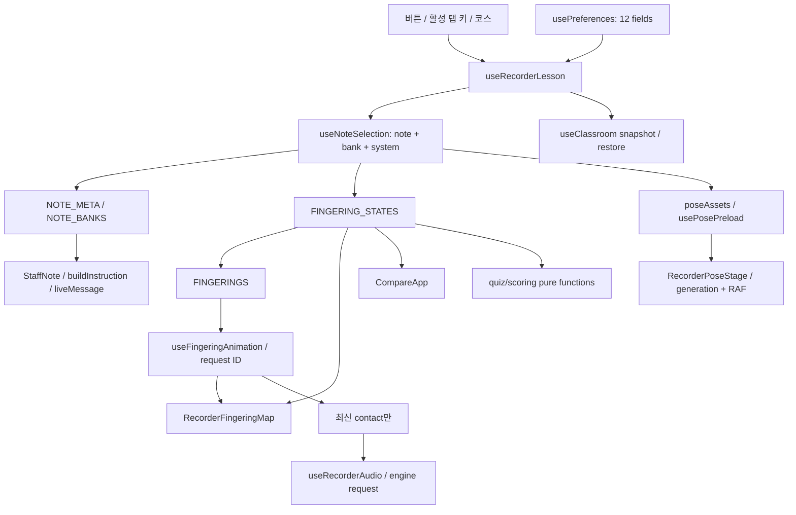

# 아키텍처

## 경계와 경로

서버 데이터베이스 없이 운지 데이터를 읽고, 브라우저 메모리·localStorage·Web Audio·Canvas로 동작한다. Next App Router를 vinext/Vite로 실행하고 Cloudflare Worker 또는 Nitro/Vercel로 빌드한다.

| 경로 | 클라이언트 책임 |
|---|---|
| `/` | RecorderLearningApp, useRecorderLesson, 선택·연습·수업 |
| `/compare` | CompareApp, 동일 데이터의 두 체계 비교와 검증된 딥링크 |
| `/quiz` | QuizApp/QuizRound, 세션 문제·채점·오답 |
| `/basics` | BasicsApp, 5카드와 useTonguing |

`app/page.tsx`의 오류 경계와 `app/layout.tsx`의 서비스 워커 등록은 학습 상태와 분리한다. 설정 복원이 끝나기 전에는 초기화가 필요한 조작을 비활성화한다. 미사용 인증 스타터는 제거했지만 Sites 빌드 플러그인과 Worker는 실제 배포에 필요하므로 유지한다. 이미지 최적화 바인딩이 없으면 일반 핸들러로 넘기고 포즈는 unoptimized로 제공한다.

## 데이터 계약

`SolfegeId` 17개, `NOTE_BANKS` 8/5/5개, `highDo` 공유로 선택 위치는 18개다. 기보 C4–G5와 실음 C5–G6는 별도 필드이며, 주파수 옵션 변경이 운지나 악보 좌표를 바꾸지 않는다.

`FINGERING_STATES[system][note]`가 T0/L1/L2/L3/R4/R5/R6/R7의 open/closed/half/partial을 모두 갖는 정답이다. `FINGERINGS`는 open 이외 구멍을 모은 접촉 호환 보기다. fa/faSharp/highFa만 두 체계의 상태와 포즈가 다르고 나머지 14음은 공유한다. 신규 음은 두 출처 검증 조건이 충족되지 않아 추가하지 않았다.

악보는 `106 - staffStep * 7`, 높은음자리표와 옥타브 위 8 기호를 사용한다. C4는 첫째 줄 아래 덧줄, 높은 도 C5는 셋째 칸이다. PNG 그림으로 논리 운지를 역추정하지 않는다.

## 훅과 소유권

| 훅 | 소유하는 상태와 정리 책임 |
|---|---|
| useRecorderLesson | 훅 연결, 설정 복원 순서, 검증된 note/bank URL 복원 |
| usePreferences | 12개 허용 필드, loaded 이후 저장, 초기화, theme 적용 |
| useReducedMotion | 미디어 질의 구독/해제 |
| useNoteSelection | 선택·음역·재시작, 실제 표시 상태 기반 전환, 오디오 요청 |
| useSequencePractice | 코스 index/playing/paused/completed, 자동 진행 타이머 |
| useGlobalShortcuts | 전역 리스너, 활성 탭 숫자키, IME/입력/도움말 가드 |
| useClassroom | 진입 스냅샷·포커스, fullscreenchange, 종료 복원 |
| usePosePreload | 활성 뱅크 즉시 로드, 나머지 idle 예약/취소 |
| useCompletionCue / useShortTone | 자신의 효과음 요청과 타이머만 정리 |
| useRecorderAudio | 사용자 제스처 unlock, 음소거, 피치 엔진 교체와 요청 취소 |

RecorderLearningApp은 208줄의 화면 조합이다. P5에서 기존 단위 테스트 124개의 이름과 결과를 유지하고 liveMessage 3개를 추가했다. 이후 기능별 테스트가 늘어 현재 164개다.

설정 복원은 오디오 훅 초기화 뒤 microtask에서 실행하고 언마운트된 복원은 취소한다. localStorage는 허용된 필드만 읽고 쓰며 잘못된 타입·범위는 기본값으로 정규화한다. 퀴즈 결과와 연습 이력은 저장하지 않는다.

## 데이터 흐름

## 세 가지 취소 경계

애니메이션은 과거 목표가 아닌 실제 표시된 `visualRef.current`에서 diff를 시작한다. 새 요청마다 request ID를 증가시키고 타이머를 해제한다. phase는 highlight-release, releasing, highlight-press, pressing, contact, settled이며 없는 단계는 건너뛴다. 단계별 보기에서는 사용자가 진행한다.

Canvas는 현재 혼합 프레임을 스냅샷하고 목표로 easeOutQuint 교차 전환한다. 보통 260ms, 느리게 720ms, reduced motion 0ms다. generation과 RAF 취소는 논리 상태 머신과 독립적이다. 이미지가 늦게 도착해도 오래된 목표를 그리지 않는다. 준비된 캔버스 뒤의 next/image 폴백은 마지막 완료 소스를 유지해 연타 때 불필요한 요청 취소를 방지한다.

오디오는 사용자 제스처 안에서 unlock을 시작하고 최신 contact에서만 재생한다. 피치 모드 교체·음소거·취소는 보류 unlock과 엔진 요청을 모두 무효화한다. UI·훅·엔진의 요청 번호를 하나로 합치지 않는다. 개별 효과음은 자신의 요청 번호를 전달해 나중에 선택한 일반 음을 중단하지 않는다.

## 코스와 퀴즈

`practiceCourses.ts`의 PRACTICE_COURSES는 6개의 steps/preferredBank를 선언한다. isCourseId/getCourse/getNoteBank는 부작용 없는 조회·검증 함수다. useSequencePractice는 자동 모드에서만 단일 타이머를 사용하며 일시정지·코스 변경·직접 선택·언마운트마다 세대를 바꾼다. 수동은 advance로만 진행하고 완주는 중복 실행되지 않는다.

`quiz/scoring.ts`의 pickDistractors는 구멍 상태 차이가 작은 오답을 고른다. scoreFingering은 8구멍의 네 상태를 비교하고 다른 체계에만 일치하면 crossSystemMatch를 반환한다. shuffle/createQuestions는 난수 함수를 주입할 수 있고 연속 중복 문제를 피한다. QuizRound의 동기 잠금 ref는 빠른 입력의 중복 채점을 막는다. identify는 1초 뒤, build는 다음 버튼으로 진행한다.

구멍 막기 지도는 opt-in interactive 모드로 각 구멍을 키보드 버튼으로 노출한다. T0의 half와 이중 구멍의 partial을 별도 상태로 순환한다. 일반 학습 지도는 기존 readonly 표현을 유지한다.

## 기초와 수업 모드

기초 5카드의 19개 문장은 설계서와 대조하는 고정 테스트로 보호한다. 자체 SVG 그림과 기존 구멍 지도를 사용한다. 텅잉은 80bpm(750ms 간격), 솔 120ms이며 음소거 시 시각 박자만 표시한다. 카드 변경·정지·언마운트에서 타이머와 자신의 소리를 정리한다.

수업 진입은 음·음역·체계·속도·단계 모드·포커스를 스냅샷한다. Fullscreen 요청 거절 시 CSS 화면을 유지하고 T/Esc/브라우저 fullscreen 종료에서 복원한다. 테마/음소거는 일반 설정으로 유지한다.

## 레이아웃과 테마

`app/globals.css`가 색·표면·텍스트·선·primary/accent·release/press 토큰을 정의한다. courses/lesson-pages/quiz/basics/classroom/high-contrast CSS는 기능별로 분리한다. 문서 루트 `data-theme="high-contrast"`가 흰 표면·검은 글자, 파랑 #0033cc 떼기, 주황 #b35c00 막기, 4px 포커스·3px 구멍 윤곽을 적용한다. Canvas 배경은 투명하다.

360px 세로와 844px 가로 규칙, 1920px 수업 화면의 70:30 배치를 별도 검증한다. 변화 칩 행은 높이를 예약하고 넘침은 내부 스크롤로 처리해 포즈 크기가 바뀌지 않는다. 실제 로드되지 않는 Pretendard 선언을 제거하고 Apple SD Gothic Neo/Malgun Gothic/system-ui를 사용한다.

## 로딩과 PWA

`poseLoader.ts`의 모듈 Map은 이미지 요청을 재사용하며 실패는 캐시에서 제거한다. `usePosePreload`는 현재 체계·뱅크를 먼저 읽고 나머지는 requestIdleCallback(최대 2초 대기), 미지원 시 1초 타이머로 예약한다. 탭 변경과 언마운트에서 과거 예약을 취소한다.

`scripts/generate-sw.mjs`는 TypeScript 컴파일러로 poseAssets를 읽고 sw.template.js에서 SHA+시각 버전의 SW를 생성한다. 두 빌드 후 실제 JS/CSS·4경로·20포즈·아이콘을 사전 캐시한다. 사용하지 않는 빌드 폰트 캐시는 제외한다. 내비게이션은 network-first, 공개 정적 파일은 cache-first다. Cloudflare Vary: Origin 대응 ignoreVary는 같은 출처 공개 정적 자산에만 사용한다.

대기 워커에는 사용자가 업데이트 버튼을 눌렀을 때만 SKIP_WAITING을 보내고 요청한 controllerchange에서 새로 고친다. 개발 모드 등록은 생략한다. 공개 assetlinks는 두 정적 산출물에 복사한다. 인증이 필요한 Sites는 공개 TWA 도메인과 구분한다.

## 검증 범위와 한계

Vitest 164개가 데이터 계약·애니메이션·30회 연타 오디오 정리·설정·코스·채점·기초·수업·preload를 검사한다. Playwright 3프로젝트의 104개 통과, 4개 명시적 제외가 현재 기준이다. axe 42회에서 serious/critical 0, Windows Chromium 포즈 기준선 20장을 비교한다. 물리 iOS/Android·스피커 청취·프로젝터 검수는 자동 결과에 포함하지 않는다.

P12 초기 JS gzip 합계는 133,419바이트로 250KiB 예산 이하다. Lighthouse CI는 선택 항목으로 실행하지 않았다. 개발 HMR multiple-renderers 경고와 개발 도구 보안 경고는 남아 있다. 정확한 인수·배포 결과는 [acceptance-v3.md](acceptance-v3.md)를 따른다.
