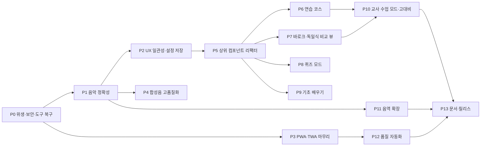

# 리코더 운지법 배우기 웹앱 — 개선·보완 바이브코딩 프롬프트 v3
## 2026-09-05 코드베이스 심층 분석 기반 · 단계별 실행 명세 (P0 ~ P13)

> 이 문서는 현재 저장소의 소스 47개 파일, 테스트 7개 파일, 설정, 자산, 문서를 직접 읽고 `npm run typecheck`, `npm run lint`, `npm test`를 실제로 실행한 결과 위에서 작성했다.
> 앞선 두 문서(`리코더_운지법_배우기_애니메이션_웹앱_바이브코딩_마스터프롬프트(GPT56Ultra).md`, `리코더_웹앱_업그레이드팩_v2_프롬프트.md`)의 원칙을 계승하되, **문서 속 계획이 아니라 실제 코드 상태**를 기준선으로 삼는다.
> 각 Phase의 `실행 프롬프트` 블록은 코딩 에이전트(Claude Code, Codex 등)에 그대로 붙여 넣을 수 있게 작성했다.

---

# 0. 이 문서 사용법

## 0.1 진행 순서와 의존 관계



| 경로 | Phase | 목적 |
|---|---|---|
| **최소(1~2일)** | P0 → P1 → P2 → P3 → P13 | 보안·정확성·배포 결함만 고치고 재배포 |
| **표준(2주)** | 최소 + P4 → P5 → P6 → P7 → P12 | 학습 기능 확장과 품질 자동화 |
| **완전(4주+)** | 표준 + P8 → P9 → P10 → P11 | 퀴즈·기초·수업 모드·음역 확장 |

한 Phase의 검증이 실패하면 다음 Phase로 넘어가지 않는다. P5(리팩터)는 P6~P10의 전제이므로 건너뛰지 않는다.

## 0.2 공통 프리앰블 — 모든 Phase 프롬프트 앞에 붙인다

```text
너는 이 저장소(리코더 운지법 배우기 웹앱: Next.js App Router 16 + React 19 + TypeScript strict,
vinext/Vite 빌드, Cloudflare Workers 및 Vercel(Nitro) 배포, Vitest + Testing Library + Playwright)의
시니어 프런트엔드 엔지니어이자 초등 음악 교육 도메인 검수자다.

작업 원칙
1. 먼저 읽고 그다음 바꾼다. 필독: README.md, docs/architecture.md, docs/animation-tuning.md,
   그리고 이 문서(리코더_웹앱_개선보완_바이브코딩_프롬프트_v3.md)의 §1 진단과 §2 불변 규칙.
2. 운지 데이터의 단일 진실 공급원은 src/features/recorder/data/fingerings.ts의 FINGERING_STATES다.
   운지 배열을 컴포넌트·테스트·문서에 복제하지 않는다. FINGERINGS는 접촉 호환 보기일 뿐이다.
3. 애니메이션·오디오의 취소 규약(useFingeringAnimation의 request ID, RecorderPoseStage의
   generation/RAF 취소, useRecorderAudio의 requestId)을 우회하는 타이머를 새로 만들지 않는다.
4. 테스트가 사용하는 data-testid·data-* 속성 이름(recorder-scene, recorder-fingering-map,
   note-button-*, note-bank-*, live-region, data-hole-id, data-hole-state, data-closed-holes,
   data-rendered-source 등)은 바꾸지 않는다. 바꿔야 하면 같은 커밋에서 테스트를 고치고 이유를 보고한다.
5. 한 Phase = 한 브랜치(또는 한 커밋 묶음). Phase 끝에 반드시 아래를 모두 실행하고 결과를 그대로 보고한다.
   npm run typecheck && npm run lint && npm test && npm run build && npm run build:vercel && npm run test:e2e
6. 실패를 숨기지 않는다. 통과시키기 위해 요구사항이나 테스트를 삭제하지 않는다.
7. 색만으로 상태를 구분하지 않고, 색종이·반짝임 같은 과도한 장식을 넣지 않으며,
   교과서 스캔·출처 불명 음원·제3자 앱의 일러스트를 넣지 않는다.
8. 초등학생 대상 앱이다. 외부 분석·광고·추적 스크립트, 로그인, 서버 저장을 추가하지 않는다.
9. 파일을 삭제하거나 폴더를 옮기기 전에 grep으로 참조 0건을 확인하고, 삭제 목록을 먼저 보고한다.
10. 보고는 한국어로, §0.3 형식으로 한다.
```

## 0.3 Phase 보고 형식

```text
## Phase X 보고
- 구현 내용: (3~8줄)
- 변경 파일: 추가 / 수정 / 삭제 각각 경로와 줄 수
- 실행 명령과 결과:
  typecheck 통과|실패 / lint 오류 n·경고 n / unit 통과 n·실패 n / build 통과|실패 / build:vercel 통과|실패 / e2e 통과 n·실패 n
- 스크린샷: (UI 변화가 있으면 360×800, 844×390, 1440×900 각 1장)
- 해소한 진단 ID: D-xx, D-yy
- 남은 위험·후속 작업:
```

## 0.4 검증 명령 세트

```bash
npm run typecheck
```
```bash
npm run lint
```
```bash
npm test
```
```bash
npm run build
```
```bash
npm run build:vercel
```
```bash
npm run test:e2e
```

E2E는 `http://127.0.0.1:4173`에 개발 서버를 자동으로 띄운다. 이미 서버가 있으면 `PLAYWRIGHT_BASE_URL`을 지정한다. 처음 실행하는 컴퓨터에서는 `npx playwright install chromium`을 한 번 실행한다.

---

# 1. 현재 상태 심층 진단 (2026-09-05 실측)

## 1.1 실측 결과

| 항목 | 결과 | 세부 |
|---|---|---|
| `npm run typecheck` | 통과 | `tsc --noEmit` exit 0 |
| `npm test` (Vitest) | 통과 | 7 파일 / 109 테스트 / 3.9초 |
| `npm run lint` | **실패** | 오류 5, 경고 1,829. 전부 `tmp/github-icon-push-20260728-145205/dist/**`의 빌드 산출물에서 발생. 소스 자체의 문제는 0건 |
| E2E 마지막 실행 | 통과 | `output/playwright/results/.last-run.json` status passed. 이번 세션에서는 재실행하지 않음 |
| Git | **저장소 아님** | 프로젝트 폴더에 `.git`이 없음. README는 GitHub main → Vercel 자동 배포를 설명함 |
| 배포 | Vercel `recorder-fingering-edu` | `.vercel/project.json`. TWA 패키지명 `app.vercel.recorder_fingering_edu.twa`로 도메인 `recorder-fingering-edu.vercel.app` 추정 |

## 1.2 아키텍처 요약

```text
음역 탭·숫자 버튼·단축키·자동 연습
  → RecorderLearningApp (700줄, 모든 조정 로직)
    → selectedNote + activeBank + preferences.fingeringSystem
      → FINGERING_STATES[system][note]  (open/closed/half/partial 단일 진실)
      → FINGERINGS[system][note]        (접촉 배열, 상태 머신 입력)
      → getRecorderPoseSource(note, system) (20장 PNG 976×1360)
    → useFingeringAnimation (diff → phase 상태 머신, request ID 취소)
    → RecorderScene = RecorderPoseStage(캔버스 교차 전환) + RecorderFingeringMap(SVG 지도) + 변경 칩
    → buildInstruction (한국어 조사 처리 포함 안내 문장)
    → useRecorderAudio → WebAudioRecorderEngine (triangle 합성음, unlock은 제스처 안에서)
설정: localStorage "recorder-learning.preferences.v1" (체계·음소거·속도·구멍 번호·온보딩 5개)
PWA: manifest.webmanifest + sw.js(network-first 내비, cache-first 자산) + ServiceWorkerRegistration
```

## 1.3 그대로 유지할 강점 (건드리지 말 것)

| 영역 | 평가 |
|---|---|
| 운지 데이터 | 17음 × 2체계 전부 표준 운지표와 일치함을 이번 분석에서 재확인(바로크 파 `T0 L1 L2 L3 R4 R6 R7`, 독일 파 `T0 L1 L2 L3 R4`, 높은 레 `L2`, 높은 미·파·솔 T0 half, 도♯ R7 partial, 레♯·솔♯ R6 partial, 라♯ `T0 L1 L3 R4`). 절대 수정 금지 |
| 취소 모델 | 상태 머신 request ID, 캔버스 generation/RAF, 오디오 requestId 3중 가드. `1→8→4→5` 회귀 테스트가 unit·E2E 양쪽에 있음 |
| 한국어 문장 생성 | `buildInstruction.ts`의 조사(은/는, 을/를, 과/와, 으로/로) 자동 처리와 중단된 전환의 실제 시작 자세 반영 |
| 접근성 | live region, role=img 장면 설명, HelpDialog의 inert 배경 처리와 포커스 트랩, reduced-motion 구독 |
| 테스트 자산 | 도메인 테스트가 PNG 헤더까지 검사(976×1360, 20장), 물리 키 코드 기반 단축키 테스트 |
| 자산 규율 | 포즈 20장이 같은 크롭 프레임, 파·파♯·높은 파만 체계별 분리 |

## 1.4 발견한 결함·불일치 목록

심각도: **높음** = 보안·배포·교육 정확성 / **중간** = 사용성·유지보수 / **낮음** = 정리·성능

| ID | 심각도 | 위치 | 내용 | Phase |
|---|---|---|---|---|
| D-01 | 높음·보안 | `리코더 운지 - Google Play package/signing.keystore`, `signing-key-info.txt` | 앱 서명 키와 비밀번호 파일이 프로젝트 폴더 안에 있고 `.gitignore`에 없음. 저장소가 공개되면 Play 서명 키가 유출됨 | P0 |
| D-02 | 높음·배포 | `public/.well-known/` 없음 | TWA(Play 패키지)가 요구하는 `assetlinks.json`이 서빙되지 않음. Android 앱에서 주소창이 사라지지 않는 원인 | P3 |
| D-03 | 높음·도구 | `eslint.config.mjs`, `package.json` | `tmp/`, `output/`, `.vercel/`, `.playwright-cli/`가 린트 대상에 포함되어 `npm run lint`가 실패. README의 "lint 통과" 주장과 불일치 | P0 |
| D-04 | 높음·음악 | `StaffNote.tsx` | 오선 맨 아래 줄을 C로 사용함(`noteY = 92 - step*7`, step 0이 92=첫째 줄). 높은음자리표에서 첫째 줄은 E이므로 모든 음이 두 칸 높게 그려짐. 음자리표와 옥타브 기호(8)도 없음 | P1 |
| D-05 | 중간·음악 | `WebAudioRecorderEngine.ts` | 도 = 261.63 Hz(C4). 소프라노 리코더 실음은 C5 = 523.25 Hz. 실제 악기와 한 옥타브 차이가 나서 학생이 소리를 맞춰 볼 수 없음 | P1·P4 |
| D-06 | 중간·UX | `resolveNoteShortcut.ts` | 수정자 없는 숫자키가 항상 낮은 계이름을 선택. 높은/반음 탭을 열고 `2`를 눌러도 낮은 레가 됨. 키패드 안내 문구 "기본 음계는 숫자 1–8만 눌러도 돼요"가 탭 상태와 어긋남 | P2 |
| D-07 | 중간·UX | `PlaybackControls.tsx`, `RecorderLearningApp.tsx` | 자동 순서 연습이 낮은 8음 전용. 높은/반음 선택 중엔 `NOTE_ORDER.indexOf === -1`이라 "기본 음계 8음"만 표시 | P6 |
| D-08 | 중간·상태 | `storage.ts` | 단계별 보기·손가락 이름 설정이 저장되지 않음(README 제약으로 기록됨) | P2 |
| D-09 | 중간·메타 | `app/layout.tsx`, `manifest.webmanifest` | description이 "기본 8음 운지"로 남아 있음. 실제는 17음 3분류. OG alt·keywords도 갱신 필요 | P0 |
| D-10 | 중간·위생 | `components/Finger.tsx`(237), `FingerLayer.tsx`(141), `RecorderBody.tsx`(126), `RearThumbInset.tsx`(104), `RecorderDebugOverlay.tsx`(160), `data/fingerPoses.ts`(402), `Hole.tsx`의 `Hole` 컴포넌트, `holeLayout.ts`의 `HOLE_LAYOUT` | PNG 포즈 무대로 바뀌기 전의 SVG 손가락 리그. 현재 어디서도 import되지 않음(`HOLE_IDS`, `isHoleTransitionHighlighted`, `HoleTransition`만 사용). 약 1,200줄의 죽은 코드와 대응 CSS | P0 |
| D-11 | 중간·위생 | `app/chatgpt-auth.ts`, `worker/index.ts`, `.openai/hosting.json`, `build/sites-vite-plugin.ts`, 빈 폴더 `db/ drizzle/ examples/ tests/` | 스타터 템플릿 잔재. `chatgpt-auth.ts`는 미사용. `worker/index.ts`가 `env.ASSETS`·`env.IMAGES`를 가정하지만 바인딩이 없어 dev 로그(`.wrangler/codex-dev.err.log`)에 `Cannot read properties of undefined (reading 'fetch')` 기록 | P0 |
| D-12 | 낮음·성능 | `public/og.png`(1.3MB, 미참조), `public/og-remastered.png`(1.3MB) | 소셜 미리보기 이미지가 과대. 미참조 파일 1개 | P0 |
| D-13 | 중간·PWA | `public/sw.js` | 포즈 20장을 사전 캐시하지 않아 첫 방문 뒤 오프라인에서는 본 적 없는 음의 포즈가 없음. `CACHE_NAME` v1 고정으로 배포마다 갱신 전략 없음 | P3 |
| D-14 | 낮음·UX | `RecorderScene.tsx`, `RecorderFingeringMap.tsx`, `FingeringLegend.tsx` | 같은 범례가 3곳(장면 하단, 지도 패널 하단, SVG 내부 y=578)에 표시됨 | P2 |
| D-15 | 낮음·폰트 | `globals.css` `--font-sans` | Pretendard를 선언하지만 어디서도 로드하지 않아 항상 시스템 폰트로 폴백 | P12 |
| D-16 | 중간·구조 | `RecorderLearningApp.tsx` 700줄 | 선택·전환·단축키·시퀀스·오디오·저장·전체화면이 한 컴포넌트에 있음. 기능 추가마다 비대해짐 | P5 |
| D-17 | 낮음·타입 | `model/types.ts` `PlaybackSpeed`, `animation/motionTimings.ts` `AnimationSpeed` | 같은 유니언이 두 이름으로 존재 | P5 |
| D-18 | 중간·테스트 | `playwright.config.ts`, `e2e/` | Chromium 단일 프로젝트. axe 접근성 자동 검사 없음. 포즈 정렬 시각 회귀 없음(문서가 수동 검수만 요구) | P12 |
| D-19 | 낮음·접근성 | `globals.css` `@media (max-width: 760px) .header-actions .secondary-button` | `font-size: 0`과 `::after` 콘텍스트로 라벨을 숨기는 취약한 처리 | P2 |
| D-20 | 중간·기능 | 전체 | v2 업그레이드팩 U2~U7(합성음 고품질, 기초 배우기, 비교 뷰, 퀴즈, 코스, 교사 모드) 미구현. U1은 17음 체계로 다른 형태로 달성됨 | P4, P6~P10 |
| D-21 | 낮음·자산 | `02 Fingering/리코더_운지법(크몽)01, 05~14.png` | 원본 31장 중 11장 미사용. 높은 라·시·높은 도와 높은 반음 등 음역 확장 재료. 원본 `.ai` 파일 존재 | P11 |
| D-22 | 낮음·도구 | 프로젝트 루트 | git 저장소가 아니어서 변경 추적·되돌리기 불가 | P0 |
| D-23 | 낮음·dev | `.wrangler/codex-dev.err.log` | "Detected multiple renderers concurrently rendering the same context provider" 경고 반복(vinext RSC dev 노이즈로 추정). 원인 미확인 | P0(기록) |
| D-24 | 낮음·테마 | `RecorderPoseStage.tsx` `fillStyle = "#ffffff"` | 캔버스 배경 색이 하드코딩되어 고대비·다크 테마 도입 시 이질적 | P10 |
| D-25 | 낮음·성능 | `RecorderPoseStage.tsx` | 마운트 시 포즈 20장(약 1.5MB)을 한 번에 preload. 모바일 데이터에서 첫 로드 부담 | P12 |
| D-26 | 낮음·UX | `learning-grid` 데스크톱 배치 | 1440×900 기준 키패드(주 조작)가 첫 화면 아래에 있음(전체 높이 약 1,580px). 가로 모드 규칙에는 키패드 상단 배치가 있으나 일반 데스크톱에는 없음 | P2(측정 후 결정) |

## 1.5 v2 업그레이드팩 이행 현황

| v2 항목 | 상태 | 비고 |
|---|---|---|
| U1 높은 레 | **달성(다른 형태)** | 버튼 9 대신 3분류 탭(8/5/5). 높은 레는 높은 계이름 2번 |
| 정오표 회귀 테스트 | 달성 | `domain.test.ts`가 바로크 파·높은 레 검증 |
| U2 합성음 고품질 | 미구현 | 여전히 triangle 단일 오실레이터. 옥타브도 낮음(D-05) |
| U3 기초 배우기 | 미구현 | |
| U4 비교 뷰 | 미구현 | 설정 라디오 전환만 있음 |
| U5 퀴즈 | 미구현 | |
| U6 연습 코스 | 미구현 | 낮은 8음 단일 시퀀스만(D-07) |
| U7 교사 모드 | 부분 | 전체화면 버튼만. 고대비·확대 레이아웃·단축키 없음 |
| U8 PWA | 부분 | manifest·SW·아이콘·shortcuts 있음. 포즈 사전 캐시·업데이트 UX·오프라인 E2E 없음(D-13). TWA 검증 파일 없음(D-02) |

## 1.6 자산·데이터 인벤토리

| 항목 | 값 |
|---|---|
| 고유 음높이 | 17 (C4–G5, 기보 기준). 선택 위치 18(C5가 낮은 8·높은 1 공유) |
| 포즈 PNG | 20장, 각 976×1360, 58~87KB, 합계 약 1.5MB |
| 원본 일러스트 | `02 Fingering/리코더_운지법(크몽).ai` + PNG 31장(171×257 미리보기). 미사용 11장: 01, 05~14 |
| 참고 스크린샷 | `01 Source/Screenshot_*.jpg` 7장은 **제3자 앱** 화면(왼손연습·높은 음 연습·사이음 연습, 높은음자리표+8, 왼손/오른손 색 구분). 아이디어 참고만 허용, 일러스트·레이아웃 복제 금지 |
| 오디오 | 파일 없음. `public/audio/recorder/README.md`만 존재 |
| 저장 키 | `recorder-learning.preferences.v1` |
| E2E 테스트 | 10개 (`e2e/recorder-learning.spec.ts`) |
| 단위 테스트 | 109개 (7 파일) |

---

# 2. 불변 규칙 (모든 Phase 공통)

1. **데이터 단일 진실**: `FINGERING_STATES`만 운지의 정답이다. `FINGERINGS`, 포즈 매핑, 안내 문구, 오디오 키는 파생물이다. 새 음을 추가할 때는 부록 A의 계약 체크리스트를 전부 채운다.
2. **두 종류의 숫자를 섞지 않는다**: 분류별 UI 숫자(낮은 1–8, 높은 1–5, 반음 1–5)와 물리 구멍 0–7(`T0 L1 L2 L3 R4 R5 R6 R7`)은 타입이 다르다.
3. **`ALL_HOLES`의 물리 순서**는 diff·문구·라이브 영역의 읽기 순서다. 바꾸지 않는다.
4. **취소 규약**: 새 타이머는 `useFingeringAnimation`의 스케줄러나 각 훅의 request ID 검사 안에서만 만든다. 전역 `setTimeout` 남발 금지.
5. **포즈 프레임**: 모든 포즈 PNG는 976×1360, 같은 크롭 창, 같은 악기 위치. 새 포즈도 `domain.test.ts`의 헤더 검사를 통과해야 한다.
6. **오디오**: `AudioContext`는 사용자 제스처 안에서만 열고, 합성음은 문서·화면에서 "합성 연습음"으로 표기한다.
7. **표현**: 열림·막힘·반개방·부분 막기는 채움·윤곽·기호·문구로 함께 전달한다. 색만으로 구분 금지.
8. **언어**: 어린이 대상 존중 표현("틀림" 대신 "한 번 더 확인해요"). 문장은 짧게, 조사는 `buildInstruction.ts`의 유틸을 재사용한다.
9. **개인정보**: 로그인·서버·분석 스크립트 없음. 저장은 `localStorage`만, 저장 항목은 `RecorderPreferences`에 명시된 것만.
10. **문서 동기화**: 데이터·단축키·설정이 바뀌면 README, `docs/architecture.md`, `docs/animation-tuning.md`, HelpDialog를 같은 Phase에서 갱신한다.

---

# 3. 단계별 프롬프트

---

## P0 — 저장소 위생·보안·도구 복구

### 목표
버전 관리 기준선을 만들고, 서명 키 유출 위험을 제거하고, 린트를 복구하고, 죽은 코드와 템플릿 잔재를 정리한다. 기능 변화 0.

### 근거
D-01, D-03, D-09, D-10, D-11, D-12, D-22, D-23

### 실행 프롬프트

```text
P0(저장소 위생·보안·도구 복구)를 수행해. 기능 변화는 없어야 하고, 모든 기존 테스트가 그대로 통과해야 해.

[0. 버전 관리 기준선]
1. 프로젝트 루트에 .git이 없으면 `git init` 후 .gitignore를 확인하고 첫 커밋
   "chore: baseline before v3 improvements"를 만든다.
2. tmp/github-icon-push-20260728-145205/.git/config에서 원격 URL을 읽어 보고한다.
   원격 연결과 push는 사용자 확인 뒤에만 한다.

[1. 보안 — 최우선]
1. `리코더 운지 - Google Play package/` 폴더 전체를 .gitignore에 추가한다
   (키스토어, 비밀번호 텍스트, .aab, .apk 모두).
2. signing.keystore와 signing-key-info.txt는 저장소 밖(예: 상위 폴더 `../_release-secrets/`)으로
   옮기도록 사용자에게 제안하고, 파일 내용은 절대 출력하지 않는다.
3. 만약 과거에 GitHub에 커밋된 이력이 있다면 "Play Console에서 업로드 키 재설정 필요"를 보고에 명시한다.
4. .env.local은 이미 .env* 패턴으로 무시되는지 확인만 한다.

[2. 린트 복구]
1. eslint.config.mjs의 globalIgnores에 추가:
   "dist/**", ".vercel/**", ".vinext/**", ".wrangler/**", "output/**", "tmp/**",
   ".playwright-cli/**", "**/*.tsbuildinfo", "리코더 운지 - Google Play package/**"
2. package.json의 lint 스크립트를 `eslint .`로 단순화한다(ignore-pattern 3개 제거).
3. tmp/github-icon-push-20260728-145205/는 임시 클론(dist 산출물과 .git 포함)이다.
   [0]에서 원격 URL을 기록한 뒤 사용자 확인을 받아 삭제한다.
4. 결과: `npm run lint`가 오류 0, 경고 0.

[3. 죽은 코드 제거 — 삭제 전 grep으로 import 0건을 각각 증명하고 목록을 먼저 보고]
1. 삭제 대상: src/features/recorder/components/Finger.tsx, FingerLayer.tsx, RecorderBody.tsx,
   RearThumbInset.tsx, RecorderDebugOverlay.tsx, src/features/recorder/data/fingerPoses.ts.
2. Hole.tsx: `isHoleTransitionHighlighted`와 `HoleTransition` 타입만
   src/features/recorder/animation/holeTransition.ts로 옮기고 Hole 컴포넌트는 삭제한다.
   RecorderFingeringMap.tsx의 import 경로를 수정한다.
3. holeLayout.ts: HOLE_IDS만 사용된다. fingerings.ts의 ALL_HOLES와 중복이므로
   RecorderScene.tsx·RecorderFingeringMap.tsx를 ALL_HOLES로 바꾸고 holeLayout.ts를 삭제한다.
   (ALL_HOLES는 readonly HoleId[]이고 HOLE_IDS는 tuple이라 타입이 달라지면 `as const` 유지 여부를 판단해 보고)
4. app/chatgpt-auth.ts 삭제. 빈 폴더 db/, drizzle/, examples/, tests/ 삭제
   (build/sites-vite-plugin.ts는 drizzle 존재를 검사만 하므로 영향 없음을 확인).
5. worker/index.ts: `/_vinext/image` 분기 앞에
   `if (!env.ASSETS || !env.IMAGES) return handler.fetch(request, env, ctx);` 가드를 넣고
   Env에서 DB를 제거한다(D1 바인딩 없음).
6. globals.css에서 삭제된 컴포넌트 전용 셀렉터를 제거한다:
   .recorder-finger*, .recorder-hole*, .recorder-hole-label*, .rear-thumb-inset*, .recorder-body*,
   .recorder-hand*, .recorder-app[data-animation-preparing] 안의 .recorder-finger__pose 등.
   제거 전 각 클래스명을 src/ 전체에서 grep해 JSX 사용 0건을 확인한다.
   --recorder-finger-duration 변수는 다른 곳에서 쓰이지 않으면 함께 제거한다.

[4. 메타데이터·자산]
1. app/layout.tsx의 description을 "낮은 계이름 8음, 높은 계이름 5음, 반음 5음(C4–G5)의 소프라노 리코더
   운지를 실제 손 모양 포즈와 구멍 지도로 배우는 교육용 웹앱" 취지로 바꾸고,
   keywords에 "소프라노 리코더", "반음", "높은 음", "PWA"를 추가한다. OG alt도 17음 체계로 갱신한다.
2. public/manifest.webmanifest의 description을 같은 취지로 맞춘다.
3. public/og.png는 미참조를 grep으로 확인하고 삭제한다. og-remastered.png는 1730×909를 유지하며
   sharp 또는 pngquant로 300KB 이하로 재압축한다(layout.tsx의 width/height와 일치 확인).
4. .wrangler/codex-dev.err.log의 "multiple renderers" 경고는 재현 여부만 확인해 보고하고 이번 Phase에서 고치지 않는다.

[5. 검증·보고]
- §0.4의 6개 명령을 모두 실행한다.
- 삭제한 파일 목록과 줄 수, 남은 파일 수를 보고한다. 기존 109개 단위 테스트와 E2E 10개가 변경 없이 통과해야 한다.
- 커밋: "chore(p0): repo hygiene, lint recovery, remove legacy svg rig"
```

### 완료 기준
- `npm run lint` 오류 0 경고 0, 나머지 5개 명령 통과
- `src/` 안에 import되지 않는 컴포넌트·데이터 파일 0개
- `.gitignore`에 Play 패키지 폴더 포함, 키스토어는 저장소 밖
- 기존 테스트 문구 수정 0건

### 주의
- `HOLE_IDS`(tuple)와 `ALL_HOLES`(readonly 배열)의 타입 차이로 `RecorderFingeringMap`의 `reduce` 초기값 캐스팅이 바뀔 수 있다. `satisfies`로 안전하게 처리한다.
- CSS 제거는 시각 회귀 위험이 있으므로 제거 전후 1440·760·470 폭 스크린샷을 비교한다.

---

## P1 — 음악 정확성: 오선보와 실음 옥타브

### 목표
오선보를 높은음자리표 기준으로 바로잡고, 소리를 소프라노 리코더 실음 높이로 맞춘다. 학생이 앱 소리와 자기 악기 소리를 맞춰 볼 수 있어야 한다.

### 근거
D-04, D-05

### 실행 프롬프트

```text
P1(음악 정확성)을 구현해. 운지 데이터(FINGERING_STATES)는 건드리지 않는다.

[A. StaffNote.tsx 재작성 — 높은음자리표 기준]
1. 오선 5줄은 y = 36 + 14*i (i = 0..4), 즉 36, 50, 64, 78, 92를 유지한다.
2. 음표 중심 y = 106 - step*7 로 바꾼다. step 0(C4)이 첫째 줄 아래 덧줄(106)에 놓이고,
   step 2(E4)가 첫째 줄(92)에 놓여야 한다. 아래 표와 정확히 일치해야 한다.

   | step | 음  | y   | 덧줄 |
   |------|-----|-----|------|
   | 0    | C4  | 106 | 106  |
   | 1    | D4  | 99  | 없음 |
   | 2    | E4  | 92  | 없음 |
   | 3    | F4  | 85  |      |
   | 4    | G4  | 78  |      |
   | 5    | A4  | 71  |      |
   | 6    | B4  | 64  |      |
   | 7    | C5  | 57  |      |
   | 8    | D5  | 50  |      |
   | 9    | E5  | 43  |      |
   | 10   | F5  | 36  |      |
   | 11   | G5  | 29  | 없음 |
   | 12   | A5  | 22  | 22   |  (P11 대비)
   | 14   | C6  | 8   | 22, 8|  (P11 대비)

3. viewBox를 "0 0 220 132"로 늘려 C4 음표 머리(ry 9)가 잘리지 않게 한다.
4. 기둥: 음표가 가운데 줄(64)보다 위(작은 y)면 아래로, 아니면 위로. 길이 45 유지.
5. 높은음자리표는 자체 제작 SVG path(단순화된 형태, 저작권 무관)로 x=20~60 영역에 그리고,
   그 위에 "8"(옥타브 위 기호, 소프라노 리코더 기보 관례)을 작은 텍스트로 표시한다.
   유니코드 𝄞 텍스트는 폰트 폴백이 불안정하므로 쓰지 않는다.
6. 임시표: accidental === "sharp"면 ♯를 음표 왼쪽에 그린다. 새 prop `enharmonicLabel?: string`으로
   "도♯ = 레♭"처럼 이명동음을 오선 아래 캡션으로 표시할 수 있게 한다(NoteCard에서 반음일 때 전달).
7. NOTE_META.staffStep 값은 그대로 둔다(C4=0 … G5=11).
8. 단위 테스트 src/features/recorder/components/StaffNote.test.tsx 신설:
   step 0/2/7/11 각각의 ellipse cy, 덧줄 line 개수(step 0 → 1개, step 2 → 0개), 기둥 방향, 음자리표 존재.

[B. 실음 옥타브 — 소프라노 리코더는 기보보다 한 옥타브 높게 소리 남]
1. src/features/recorder/audio/WebAudioRecorderEngine.ts의 RECORDER_NOTE_FREQUENCIES_HZ를
   "기보 키 → 실음 주파수"로 바꾼다(A4 = 440Hz 평균율):
   C4→523.25, C#4→554.37, D4→587.33, D#4→622.25, E4→659.25, F4→698.46, F#4→739.99,
   G4→783.99, G#4→830.61, A4→880.00, A#4→932.33, B4→987.77,
   C5→1046.50, D5→1174.66, E5→1318.51, F5→1396.91, G5→1567.98
2. 엔진 옵션 `pitchMode: "sounding" | "written"`(기본 "sounding")을 추가한다. "written"이면 위 값의 1/2.
   getRecorderNoteFrequency(noteKey, pitchMode)로 시그니처를 확장하고 기본값을 유지한다.
3. RecorderPreferences에 `pitchMode` 필드를 추가하고(기본 "sounding"), SettingsPanel에
   SegmentedControl "소리 높이: 실제 리코더 소리 / 한 옥타브 낮게"를 추가한다.
   parsePreferences는 값이 없거나 잘못되면 기본값으로 보정한다(저장 키 v1 유지, 하위 호환).
4. NOTE_META에 `soundingPitch: string`을 추가한다(C4→"C5" … G5→"G6").
   NoteCard의 "음 이름 C4" 아래에 작은 보조 문구 "실제 소리 C5"를 표시한다.
   E2E `.note-name` toHaveText("음 이름 C4") 검사는 그대로 통과해야 하므로 보조 문구는 별도 요소로 둔다.
5. 고음 보호: 실음 모드에서 1,000Hz 이상 음은 PEAK_GAIN·SUSTAIN_GAIN을 0.75배로 낮춘다(귀에 날카롭지 않게).
6. 테스트 갱신: RecorderAudioEngine.test.ts의 17주파수 검사를 두 모드 모두 검사하도록 확장.
   domain.test.ts "persists only the five allowed preferences"는 6개 필드로 갱신.
   useRecorderAudio에 pitchMode를 전달하는 경로(엔진 팩토리 옵션)를 추가하고 컴포넌트 테스트를 추가한다.

[C. 문서]
- README "알려진 제약"의 "주파수 범위는 C4–G5" 문장을 실음/기보 두 모드 설명으로 바꾸고,
  public/audio/recorder/README.md의 피치 키 표에 실음 열을 추가한다.

[검증] §0.4 전체. 스크린샷: NoteCard의 도·높은 도·도♯·높은 솔 4장.
커밋: "feat(p1): treble-clef staff with 8va and sounding-pitch audio"
```

### 완료 기준
- 도가 첫째 줄 아래 덧줄, 높은 도가 셋째 칸, 높은 솔이 다섯째 줄 위에 그려진다
- 기본 설정에서 도 재생 주파수가 523.25 Hz, "한 옥타브 낮게"에서 261.63 Hz
- 새 테스트 포함 전부 통과, E2E 문구 검사 변경 없음

### 주의
- 반음 노트의 `noteName`은 "C♯4 / D♭4" 형식이다. E2E가 이 문자열을 검사하므로 바꾸지 않는다.
- `enharmonicLabel`은 표시용일 뿐 데이터 모델에 새 필드를 만들지 않는다(NOTE_META.solfegeKo에서 파생).

---

## P2 — UX 일관성과 설정 저장

### 목표
숫자키가 열려 있는 탭을 따르게 하고, 모든 설정을 저장하고, 중복 범례와 취약한 CSS를 정리한다.

### 근거
D-06, D-07(임시), D-08, D-14, D-19, D-26

### 실행 프롬프트

```text
P2(UX 일관성·설정 저장)를 구현해.

[A. 숫자키가 활성 탭을 따르도록]
1. resolveNoteShortcut(event, activeBank: NoteBank = "low")로 시그니처를 확장한다.
   - 수정자 없음: activeBank의 digit 매핑. 범위 밖(높은/반음 탭에서 6~8)은 null.
   - Ctrl: 항상 low. Shift: 항상 high. Alt: 항상 chromatic. 복합 수정자·Meta·repeat·IME·AltGraph 거부는 그대로.
2. RecorderLearningApp(또는 P5 이후의 useGlobalShortcuts)에서 activeBank를 넘긴다.
3. 테스트 갱신: resolveNoteShortcut.test.ts에 "높은 탭에서 2 → highRe", "높은 탭에서 7 → null",
   "Ctrl+2는 탭과 무관하게 re" 케이스 추가. RecorderLearningApp.test.tsx "maps Shift, Alt, and Ctrl chords"는
   유지되어야 하고, E2E "keyboard 5 selects 솔"은 low 탭 기본 상태라 그대로 통과해야 한다.
4. 문구 갱신: NoteKeypad의 keyboard-hint "숫자 키는 지금 열린 탭의 음을 골라요. Ctrl·Shift·Alt로 탭을 건너뛸 수 있어요",
   HelpDialog의 키보드 표 첫 줄 "1–8 지금 열린 탭의 음", README 단축키 표.

[B. 설정 저장 확장]
1. RecorderPreferences에 stepMode: boolean(기본 false), showFingerNames: boolean(기본 false) 추가.
   (P1의 pitchMode 포함 총 8개.) STORAGE_KEY는 v1 유지, parsePreferences 기본값 보정.
2. RecorderLearningApp의 로컬 useState(stepMode, showFingerNames)를 preferences로 이관한다.
   단계별 보기가 저장된 상태로 새로 고침되면 첫 렌더에서 phase "idle"과 1/7 표시가 정확해야 한다
   (초기 마운트 경로 useFingeringAnimation의 mountedRef 분기를 확인).
3. SettingsPanel 하단에 "설정 초기화" text-button 추가: DEFAULT_PREFERENCES로 되돌리고
   온보딩은 다시 띄우지 않음(onboardingCompleted는 유지). 확인 대화 없이 즉시 적용, aria-live로 "설정을 처음 상태로 되돌렸어요".
4. 테스트: storage 라운드트립(8필드), 새로 고침 후 stepMode 복원 컴포넌트 테스트.
5. README "알려진 제약"에서 "단계별 보기와 손가락 이름은 새로 고침 뒤 유지되지 않습니다" 문장 삭제.

[C. 범례 단일화]
1. RecorderScene의 .fingering-map-panel__legend와 RecorderFingeringMap 내부 SVG 범례(y=578 그룹)를 제거하고
   FingeringLegend 하나(장면 카드 하단)만 남긴다. SVG viewBox 높이를 620→560으로 줄여 남는 여백을 없애되
   MAP_HOLE_LAYOUT 좌표는 바꾸지 않는다.
2. FingeringLegend의 항목 순서를 지도 색과 일치시킨다: 열림 ○, 막힘 ●, 반개방 ◐, 한쪽만 ◒, ↑ 떼기(파랑), ↓ 막기(주황).

[D. 헤더 버튼 모바일 처리]
- globals.css의 `.header-actions .secondary-button { font-size: 0 }` + `::after` 방식 제거.
  버튼 내부를 <span aria-hidden>아이콘</span><span class="button-label">도움말</span>으로 나누고
  760px 이하에서 .button-label에 .sr-only를 적용한다. aria-label은 유지.

[E. 첫 화면 노출 측정(D-26)]
1. Playwright로 1440×900, 1366×768에서 .scene-card와 .keypad-card의 boundingBox를 측정해 보고한다.
2. 키패드가 첫 화면 밖이면 데스크톱(>1080px) grid-template-areas를
   "note scene keypad" / "instruction scene settings" 로 바꾸는 실험을 하고 전후 스크린샷을 비교한다.
   장면 카드 높이가 줄어들거나 포즈가 작아지면 채택하지 않고 이유를 보고한다.
3. 채택 시 E2E에 "1366×768 desktop keeps scene and keypad in first viewport" 테스트를 추가한다.

[F. 순서 연습 표시 임시 수정(D-07)]
- 현재 음이 NOTE_ORDER 밖이면 PlaybackControls에 "낮은 계이름 8음 · 시작하면 도부터 진행해요"로 정확히 안내한다.
  (P6에서 코스 모델로 대체되므로 최소 수정.)

[검증] §0.4 전체 + 스크린샷 3장(360·844 가로·1440).
커밋: "feat(p2): bank-aware digit keys, persisted step/finger-name prefs, single legend"
```

### 완료 기준
- 높은 탭에서 `2`를 누르면 높은 레, 반음 탭에서 `1`은 도♯, 낮은 탭에서 `5`는 솔
- 새로 고침 뒤 단계별 보기·손가락 이름·소리 높이 유지
- 범례가 한 곳에만 표시
- 기존 E2E 10개 + 신규 통과

---

## P3 — PWA·TWA 배포 마무리

### 목표
Android TWA 검증을 통과시키고, 오프라인에서 17음 전부가 동작하게 하고, 업데이트 UX를 만든다.

### 근거
D-02, D-13, U8

### 실행 프롬프트

```text
P3(PWA·TWA 배포 마무리)를 구현해.

[A. Digital Asset Links]
1. public/.well-known/assetlinks.json을 만든다. 내용은
   `리코더 운지 - Google Play package/assetlinks.json`과 동일하게(package_name
   app.vercel.recorder_fingering_edu.twa, sha256_cert_fingerprints 그대로). 지문은 공개 정보라 커밋해도 된다.
2. `npm run build:vercel` 뒤 .vercel/output/static/.well-known/assetlinks.json이 생성되는지 확인한다.
   Nitro가 dot 폴더를 복사하지 않으면 다음 중 하나로 보장한다:
   (a) vercel.json에 { "rewrites": [{ "source": "/.well-known/assetlinks.json", "destination": "/assetlinks.json" }] }
       를 추가하고 public/assetlinks.json으로 이동, 또는
   (b) app/.well-known/assetlinks.json/route.ts에서 JSON을 반환(Content-Type application/json).
3. `npm run build`(Cloudflare 번들)에서도 같은 경로가 서빙되는지 dist/client에서 확인한다.
4. pwa.test.ts에 "assetlinks.json이 존재하고 package_name이 TWA와 일치" 테스트를 추가한다.
5. 배포 후 수동 검증 절차를 README에 적는다:
   curl -sI https://<배포 도메인>/.well-known/assetlinks.json → 200, content-type: application/json
   Android 기기에서 TWA 실행 시 주소창이 사라지는지 확인.

[B. 포즈 사전 캐시와 SW 버전]
1. scripts/generate-sw.mjs를 만든다: src/features/recorder/data/poseAssets.ts를 import(tsx 또는 정적 파싱)해
   RECORDER_POSE_SOURCES 배열과 아이콘·매니페스트 경로로 PRECACHE_URLS를 생성하고,
   CACHE_NAME을 `recorder-fingering-<git short sha 또는 빌드 시각>`으로 치환해 public/sw.js를 쓴다.
   public/sw.template.js를 원본으로 두고 sw.js는 생성물로 취급한다(단, 저장소에는 최신 생성물도 커밋).
2. package.json: "prebuild"와 "prebuild:vercel"에 `node scripts/generate-sw.mjs`를 연결한다.
3. sw.js에 message 리스너 추가: { type: "SKIP_WAITING" } 수신 시 self.skipWaiting().
   install 단계의 자동 skipWaiting은 제거해 사용자가 새로 고침 시점을 고르게 한다.
4. pwa.test.ts에 "SW PRECACHE가 20개 포즈 경로를 모두 포함" 테스트 추가(poseAssets.ts와 대조).

[C. 업데이트 UX]
- ServiceWorkerRegistration.tsx: registration.waiting 또는 updatefound → installed(waiting) 시
  하단에 작은 토스트 "새 버전이 준비되었어요 [새로 고침]"을 렌더한다(role="status", aria-live="polite").
  버튼 클릭 → waiting.postMessage({type:"SKIP_WAITING"}) → controllerchange에서 location.reload().
  ServiceWorkerRegistration.test.tsx에 waiting 워커 시나리오 테스트 추가.

[D. manifest 보강]
- display_override: ["standalone", "minimal-ui"], screenshots에 narrow form_factor(360×800 캡처, public/screenshots/mobile.png) 추가.
  description은 P0와 동일 문구. pwa.test.ts 갱신.

[E. 오프라인 E2E]
- e2e에 "offline after first visit keeps all 17 poses": 온보딩 완료 → SW 활성 대기
  (navigator.serviceWorker.ready) → page.context().setOffline(true) → reload →
  세 탭의 18개 버튼을 순회하며 .recorder-pose-stage의 data-rendered-source가 각 포즈로 바뀌는지 확인.
  Chromium에서만 실행(webkit은 SW 제약), test.skip 조건 명시.

[검증] §0.4 전체. 추가로 `npm run build:vercel` 산출물에서 .well-known 경로 존재를 ls로 보고.
커밋: "feat(p3): assetlinks, versioned sw with pose precache, update toast, offline e2e"
```

### 완료 기준
- 로컬 빌드 산출물 두 종류 모두에 `/.well-known/assetlinks.json` 존재
- 오프라인 E2E 통과, SW 캐시 이름이 빌드마다 달라짐
- 새 버전 배포 시 토스트가 뜨고 새로 고침으로 교체됨

### 주의
- 개발 서버(vinext dev)에서는 SW가 HMR 경로를 캐시하지 않도록 `isDevRuntimePath` 규칙을 유지한다.
- 키스토어 관련 파일은 P0에서 저장소 밖으로 나갔으므로 여기서는 `assetlinks.json`만 다룬다.

---

## P4 — 합성음 고품질화 (리코더다운 소리)

### 목표
샘플 없이도 "리코더답게" 들리는 Web Audio 폴백을 만든다. 엔진 계약과 취소 규약은 그대로.

### 근거
D-05, D-20(U2)

### 실행 프롬프트

```text
P4(합성음 고품질화)를 구현해. RecorderAudioEngine 인터페이스(unlock/preload/play/stop/setMuted/dispose),
useRecorderAudio의 beginPlaybackRequest/playAtContact 계약, 600–900ms 길이 clamp, 55ms 전환 페이드 규약을 유지한다.

[A. 음색 그래프 — src/features/recorder/audio/recorderTimbre.ts 신설]
리코더는 기음이 지배적인 플루트계 악기다. play(noteKey)마다 아래 노드를 생성하고 끝나면 disconnect한다.
1. osc1: sine, f, gain 1.00
2. osc2: sine, 2f, gain 0.16  (f ≥ 1000Hz이면 0.08)
3. osc3: sine, 3f, gain 0.06  (f ≥ 1000Hz이면 0.03)
4. 어택 치프(chiff): 50ms 화이트노이즈 AudioBuffer(컨텍스트당 1회 생성·재사용) →
   BiquadFilter bandpass(frequency 2f, Q 6) → gain 0.10을 첫 30ms에만 섞고 exponentialRamp로 0.0001까지 내린다.
5. 마스터 엔벨로프(GainNode): attack 35ms linear → sustain 0.8 → 마지막 fadeOutMs(기본 125) exponential release.
   기존 PEAK_GAIN/SUSTAIN_GAIN 상수를 재사용하고 P1의 고음 보호(≥1000Hz → 0.75배)를 적용한다.
6. 비브라토: LFO sine 4.5Hz → 마스터 gain에 ±1.5% 진폭 변조. 옵션 `vibrato: boolean`(기본 true).
7. 옵션 `timbre: "recorder" | "triangle"`(기본 "recorder"). "triangle"은 기존 구현을 그대로 유지해 A/B 비교와 테스트 회귀에 쓴다.

[B. 엔진 통합]
1. WebAudioRecorderEngine.startVoice를 timbre에 따라 분기한다. ActiveVoice는 oscillator 1개 대신
   `sources: AudioScheduledSourceNode[]`와 `nodes: AudioNode[]`를 가지며 fadeVoice/releaseVoice/silenceAllVoicesImmediately가
   모든 source를 stop·disconnect한다. voices Set은 재생 종료 뒤 반드시 0이 되어야 한다.
2. 새 음이 시작되면 이전 음은 transitionFadeMs(55) 동안 페이드 — 기존 규약 그대로.
3. dispose에서 노이즈 버퍼 참조를 해제한다.

[C. 검증 도구]
1. ?debug=1 디버그 패널에 "17음 연속 재생(0.5초 간격)" 버튼을 추가한다(production 빌드 제외 유지).
2. 30회 연타 뒤 engine의 voices.size === 0, 콘솔 경고 0을 테스트로 고정한다(mock AudioContext).
3. RecorderAudioEngine.test.ts: recorder 음색에서 play 1회당 생성되는 OscillatorNode 3개·BufferSource 1개·Biquad 1개·Gain 노드 수를
   mock으로 검사, stop 뒤 모든 노드 disconnect 호출 확인, triangle 모드 기존 테스트 유지.

[D. 문서]
- README 오디오 절과 public/audio/recorder/README.md: 여전히 "합성 연습음"이며 실제 녹음이 아님을 명시.
  음색 파라미터 표(위 A의 값)와 조정 위치를 적는다.

[검증] §0.4 전체. 브라우저에서 도~높은 솔을 실제로 들어 보고 "발음감(치프) 유무, 음정 상승, 날카로움"을 주관 평가로 보고.
커밋: "feat(p4): recorder-like synth timbre with chiff, harmonics, vibrato"
```

### 완료 기준
- 17음이 실음 높이로 서로 다른 피치로 재생되고 시작에 짧은 '투' 발음감이 있다
- 연타 30회 뒤 노드 누수 없음, 이전 음 지연 재생 없음
- triangle 폴백 옵션으로 회귀 비교 가능

---

## P5 — 상위 컴포넌트 리팩터 (행위 변화 0)

### 목표
`RecorderLearningApp.tsx` 700줄을 훅으로 분리해 P6~P10의 기능 추가가 안전하게 들어갈 자리를 만든다.

### 근거
D-16, D-17

### 실행 프롬프트

```text
P5(리팩터)를 수행해. 이 Phase의 목표는 행위 변화 0이다. 기존 109+개 단위 테스트와 E2E를 문구 수정 없이 통과시켜야 하며,
테스트를 바꿔야만 하는 경우 그 이유를 먼저 보고하고 승인 뒤 진행한다.

[A. 훅 분리 — src/features/recorder/hooks/]
1. usePreferences.ts: load/save/patch/reset, preferencesLoaded, URL ?bank= 초기 반영.
   savePreferences는 loaded 이후에만. 반환: { preferences, loaded, update, reset }.
2. useReducedMotion.ts: 기존 usePrefersReducedMotion 이동.
3. useNoteSelection.ts: selectedNote, activeBank, transitionOrigin, animationKey/animationRestart, requestAnimation,
   getReplayStart, selectNote(note, {stopSequence, play, bank}), changeSystem, goPrevious, goNext, replay.
   오디오 요청 시작/취소는 콜백 인자로 주입받아 결합도를 낮춘다.
4. useSequencePractice.ts: sequencePlaying/paused, toggle/reset, 진행 타이머(P6에서 코스 모델로 확장할 수 있게
   `steps: readonly SolfegeId[]`, `intervalMs`를 인자로 받는 구조로 만들되 이번엔 NOTE_ORDER와 1500/2000을 그대로 넘긴다).
5. useGlobalShortcuts.ts: keydown 리스너(helpOpen·typing target·IME 가드 포함), resolveNoteShortcut(event, activeBank) 호출,
   화살표·스페이스 처리.
6. utils/liveMessage.ts: withKoreanSubjectParticle, describeFingeringForLive 이동(+ 단위 테스트 3개 추가).
7. RecorderLearningApp.tsx는 훅 조합과 JSX만 남겨 250줄 이하로 만든다.

[B. 타입 정리]
- model/types.ts의 PlaybackSpeed를 제거하고 motionTimings.ts의 AnimationSpeed를 단일 정의로 쓴다
  (또는 반대). 남은 이름을 types.ts에서 re-export 해 import 경로 변경을 최소화한다.

[C. 안전장치]
1. 리팩터 전 `npm test -- --reporter=json > output/unit-before.json`, 후 `output/unit-after.json`을 저장해 테스트 수와 이름이 동일함을 diff로 보고.
2. E2E도 전후 통과 개수 동일.
3. React DevTools 없이 확인 가능한 렌더 횟수 회귀 방지: RecorderScene에 렌더 카운트를 세는 임시 테스트를 넣어
   음 1회 선택 시 렌더 횟수가 리팩터 전과 같거나 적음을 확인하고 임시 코드를 제거한다.

[D. 문서]
- docs/architecture.md의 "주요 디렉터리"와 "데이터 흐름"에 hooks/ 추가.

[검증] §0.4 전체.
커밋: "refactor(p5): split RecorderLearningApp into hooks without behavior change"
```

### 완료 기준
- `RecorderLearningApp.tsx` ≤ 250줄, 훅 5개 + 유틸 1개
- 테스트 이름·개수 전후 동일, 전부 통과
- 문구·DOM 구조·data-* 속성 변경 0

---

## P6 — 연습 코스 확장

### 목표
낮은 8음 단일 시퀀스를 손 분리 학습 기반의 코스 6종으로 확장하고, 수업에서 실제 리코더를 따라 부는 수동 진행을 지원한다.

### 근거
D-07, D-20(U6)

### 실행 프롬프트

```text
P6(연습 코스)를 구현해. P5의 useSequencePractice를 확장한다.

[A. 데이터 — src/features/recorder/data/practiceCourses.ts]
export interface PracticeCourse { id; titleKo; description; steps: readonly SolfegeId[]; bank: NoteBank; handHint?: string }
1. leftHand   "왼손 코스"      sol, la, si, highDo, highRe            bank high(공유 C5는 high 1번으로 표시)  handHint "오른손은 그대로 쉬어요"
2. rightHand  "오른손 코스"    do, re, mi, fa                          bank low   handHint "왼손은 그대로!"
3. lowScale   "낮은 계이름"    NOTE_ORDER 8음                          bank low
4. highScale  "높은 계이름"    HIGH_NOTE_ORDER 5음                     bank high
5. chromatic  "반음"           CHROMATIC_NOTE_ORDER 5음                bank chromatic
6. fullRange  "한 옥타브 반"   do re mi fa sol la si highDo highRe highMi highFa highSol (12음, 반음 제외)  bank는 음마다 자동
- 각 step은 NOTE_META에 존재해야 한다는 단위 테스트, 코스 id 유일성 테스트, 순서 스냅샷 테스트.

[B. 진행 모델 — useSequencePractice 확장]
1. 상태: courseId, index, playing, paused, mode: "auto" | "manual", intervalMs(1200~3000, 기본 보통 1500 / 느리게 2000).
2. auto: 기존 타이머 규약(요청 ID 검사, cleanup). manual: 타이머 없이 "다 했어요! 다음" 버튼으로 진행.
3. 사용자가 숫자 버튼·단축키로 직접 음을 고르면 안전 중지(기존 규칙 회귀 테스트 유지).
4. 각 음에서 InstructionPanel 문장 위에 코스 handHint를 덧붙인다(왼손/오른손 코스만).
5. 마지막 음 뒤 "완주" 상태. reduced-motion·음소거 반영.

[C. UI — PlaybackControls → CoursePanel.tsx]
1. 코스 선택: 6개 카드(제목·음 수·첫 음~끝 음), 현재 탭에 맞는 코스를 기본 제안.
2. 컨트롤: 시작/일시정지/처음으로, 자동↔수동 스위치(role="switch"), 간격 슬라이더(input type=range, 0.1s 단위, aria-valuetext "1.5초").
3. 진행바(role="progressbar", aria-valuenow) + "n/전체" + 현재 음 이름.
4. 완주 화면: 별 3개가 300ms 간격으로 켜짐(reduced-motion이면 동시), "○○ 코스 완주!", 짧은 상행 아르페지오(합성 3음, 각 180ms, 음소거 시 생략),
   [다른 코스] [한 번 더]. 색종이·전체 화면 애니메이션 금지.
5. preferences에 lastCourseId, courseIntervalMs, courseMode 저장(RecorderPreferences 확장, parse 보정, storage 테스트 갱신).

[D. 테스트]
- 단위: 코스 데이터 검증, 수동 모드에서 타이머 미생성, auto 모드 interval 반영, 완주 상태 전이.
- 컴포넌트: 코스 선택 → 첫 음 선택·탭 전환, 직접 선택 시 중지, 일시정지/이어서.
- E2E: 기존 "sequence starts at 도 and resumes" 테스트를 lowScale 코스 기준으로 갱신,
  "leftHand course manual mode advances with 다 했어요 button" 추가.

[E. 문서] README 사용 방법·단축키 표, architecture.md 코스 절.
커밋: "feat(p6): six practice courses with auto/manual progression"
```

### 완료 기준
- 6개 코스가 자동·수동 두 방식으로 완주 가능
- 직접 선택 시 안전 중지, 타이머 누수 없음
- 기존 연타 안정성 테스트 통과

---

## P7 — 바로크식·독일식 비교 뷰

### 목표
두 체계의 차이(파·파♯·높은 파)를 한 화면에서 나란히 이해시킨다.

### 근거
D-20(U4)

### 실행 프롬프트

```text
P7(비교 뷰)를 구현해. RecorderScene을 복제하지 말고 props로 재사용한다.

[A. RecorderScene 확장]
- props 추가: readonly?: boolean(변경 칩·상태 문구 숨김), compact?: boolean(포즈 패널 topline·hand-guide 숨김).
  transitionKey는 인스턴스별로 독립. 기존 기본값 동작은 변하지 않아야 한다(스냅샷 테스트).

[B. 라우트 app/compare/page.tsx (App Router)]
1. 상단: 음 선택 세그먼트(파 / 파♯·솔♭ / 높은 파) — FINGERING_STATES에서 두 체계가 다른 음만 자동 추출
   (하드코딩 금지: ALL_NOTE_IDS.filter(n => !deepEqual(baroque[n], german[n]))). 다른 음을 URL ?note=로 열면
   "이 음은 두 방식이 같아요" 배지를 크게 표시하고 장면을 하나만 렌더.
2. 좌우 2단(모바일 상하): 왼쪽 독일식, 오른쪽 바로크식. 각 단 = 축소 RecorderScene(readonly, compact) + 체계 이름 + 막는 구멍 번호.
3. 차이 배지: getFingeringDiff(baroque, german) 결과로 문장 생성 — 예) "바로크식에서 독일식으로: 6·7번을 열어요".
   buildInstruction.ts의 조사 유틸(formatFingerNames 등)을 export해 재사용.
4. 하단 요약 카드(원문 유지):
   "독일식: 파를 쉽게 불 수 있어 학교에서 많이 써요.
    바로크식: 반음(올림·내림) 연주에 유리하고 세계적으로 널리 써요.
    내 리코더 뒷면에 B(바로크)나 G(독일) 표시를 확인해 보세요!"
5. [이 체계로 배우기] 버튼 ×2 → preferences.fingeringSystem 반영 → "/?note=<id>&bank=<bank>"로 이동.
   메인이 ?note=를 받도록 getRequestedBank를 getRequestedSelection(bank, note)으로 확장한다(잘못된 값 무시).
6. 진입점: SettingsPanel 운지 체계 옆 "비교해 보기" 링크, OnboardingBanner에 "잘 모르겠어요 → 비교해 보기", HelpDialog.
7. manifest shortcuts에 "운지 체계 비교" (/compare) 추가, pwa.test.ts 갱신.

[C. 테스트]
- 컴포넌트: 파에서 왼쪽 R6·R7 open / 오른쪽 R6·R7 closed, R5 양쪽 open; 솔에서 "두 방식이 같아요" 배지.
- E2E: /compare → 독일식 선택 → 메인에서 라디오 독일식 checked, 파 포즈 fa-german.png.
커밋: "feat(p7): side-by-side baroque/german comparison route"
```

### 완료 기준
- 세 음의 두 장면 구멍 상태가 `FINGERING_STATES`와 1:1 일치
- 체계 선택이 메인 설정에 반영되고 딥링크로 해당 음이 열림

---

## P8 — 퀴즈 모드 2종

### 목표
배운 운지를 확인한다. 채점은 순수 함수로 분리해 데이터와 1:1 일치시킨다.

### 근거
D-20(U5)

### 실행 프롬프트

```text
P8(퀴즈)를 구현해. src/features/quiz/ 모듈과 app/quiz/page.tsx 라우트를 만든다.
공통: 한 라운드 10문제, "문제 n/10"과 점수, 같은 음 연속 출제 금지, 현재 운지 체계를 따름,
범위 선택(낮은/높은/반음/전체), 점수는 세션 메모리만(로컬 저장 금지), 채점 뒤 입력 잠금으로 이중 채점 방지.
언어 원칙: "틀림" 대신 "한 번 더 확인해요". 흔들기 애니메이션·색종이 금지.

[A. 채점 순수 함수 — src/features/quiz/scoring.ts]
1. pickDistractors(answer, pool, count=3): getFingeringDiff 크기가 작은 음 우선, 정답 중복 금지, 부족하면 무작위 보충.
2. scoreFingering(answer: FingeringStateMap, target note, system) →
   { perHole: Record<HoleId, "correct" | "wrong">, correctCount, total: 8, exact: boolean,
     crossSystemMatch: FingeringSystem | null }  // 다른 체계의 같은 음과 정확히 일치하면 그 체계
3. 단위 테스트: 오답 중복 없음, 파 교차 체계 인정(바로크 설정에서 독일식 파 입력 → crossSystemMatch "german"),
   half/partial 구멍 정확 비교(높은 미 T0 closed는 wrong).

[B. 퀴즈 1 — 운지 보고 계이름 맞히기]
1. RecorderScene(readonly, compact)에 무작위 음의 완성 운지 표시, 계이름·음 이름 숨김(title/desc도 "문제 운지"로).
2. 보기 4개(버튼, 1~4 숫자키·화살표+Enter). 정답: 성공 색+✓ 아이콘+해당 음 500ms 재생+"딩동댕!" → 1초 후 다음.
   오답: 누른 버튼 테두리만 danger 색+"한 번 더 확인해요. 정답은 ○○예요"+정답 버튼 표시+정답 음 재생 → 다음.

[C. 퀴즈 2 — 계이름 보고 구멍 막기]
1. 문제: 계이름 크게 + [들어보기]. 장면은 RecorderFingeringMap만(포즈는 정답 확인 뒤 표시).
2. RecorderFingeringMap에 interactive 모드 추가: MapHole을 <g role="button" tabIndex=0 aria-pressed>로,
   클릭/Enter/Space로 상태 순환. 순환 규칙: 일반 구멍 open→closed→open, T0 open→closed→half→open,
   R6/R7 open→closed→partial→open. 상태 변화를 aria-live로 "3번 구멍 막음".
   비인터랙티브 기본 동작과 data-* 속성은 변하지 않아야 한다(기존 테스트 유지).
3. [확인] → scoreFingering. 맞은 구멍 성공 링, 다른 구멍 안내 링+올바른 상태 표시, "8개 중 7개!" 부분 점수.
   exact면 축하 아르페지오(P6 재사용). crossSystemMatch면 "그건 ○○식 파예요! 둘 다 맞아요" 안내 후 정답 처리.
   확인 뒤 RecorderPoseStage로 정답 포즈를 보여 준다.

[D. 결과 화면]
- 90점 이상 "리코더 박사!", 70 이상 "잘했어요!", 그 외 "조금만 더 연습해요!". 결과 카드 페이드인만.
- 헷갈린 음 목록 + [이 음 복습하기] → "/?note=<id>&bank=<bank>". [다시 도전].
- 탭 이탈→복귀: 상태 유지(세션 메모리). 새로 고침은 초기화. 이유를 README에 한 줄.

[E. 테스트·진입점]
- E2E: 퀴즈 2에서 구멍 3개 토글 → 확인 → "8개 중" 문구; 퀴즈 1에서 1~4 키로 답하기.
- 헤더에 "퀴즈" 링크, manifest shortcut, HelpDialog.
커밋: "feat(p8): fingering quizzes with pure scoring and interactive hole map"
```

### 완료 기준
- 두 퀴즈 모두 10문제 완주·채점·복습 이동
- 채점 결과가 `FINGERING_STATES`와 1:1, 교차 체계 인정 동작
- 인터랙티브 지도 도입 뒤 기존 지도 테스트 변경 0

---

## P9 — 기초 배우기 모듈

### 목표
운지 이전 단계(자세·잡는 법·입 모양·텅잉·손가락 위치)를 독립 화면으로 제공한다.

### 근거
D-20(U3)

### 실행 프롬프트

```text
P9(기초 배우기)를 구현해. src/features/basics/ 모듈과 app/basics/page.tsx 라우트.
카드 슬라이드(터치 스와이프 + 이전/다음 + 진행 점 1/5~5/5). 각 카드 제목은 h2, 슬라이드 전환을 aria-live로 안내.
그림은 전부 자체 제작 SVG. 교과서 스캔·제3자 앱 화면 사용 금지.

[문구 — 아래 원문을 그대로 사용. 단, 출처가 교과서라면 사용자에게 확인을 요청하고 승인 전에는 자체 문장으로 바꾼다]

카드 1. 바른 자세 — [앉아서|서서] 세그먼트
■ 앉아서
- 의자 등받이에서 허리를 떼고 앉습니다.
- 두 발을 어깨너비 정도로 벌려 바닥에 댑니다.
- 발은 바닥에 가볍게 붙여 중심을 잡도록 합니다.
- 손가락이나 어깨의 긴장을 풀어 줍니다.
■ 서서
- 양발을 어깨너비 정도로 벌려서 몸의 중심을 잡도록 합니다.
- 머리를 똑바로 하고 시선은 정면을 향합니다.
- 허리를 펴고 팔꿈치는 몸에서 조금 떨어지게 합니다.
- 손가락이나 어깨에 힘이 들어가지 않도록 긴장을 풀어 줍니다.
일러스트: 앉은/서 있는 사람의 단순 라인 SVG. 허리·발·어깨에 점 표시.

카드 2. 리코더 잡는 법
- 왼손이 위, 오른손이 아래! (가장 크게)
- 왼손: 엄지는 뒷구멍(0번), 검지·중지·약지가 1·2·3번 구멍
- 오른손: 검지·중지·약지·새끼가 4·5·6·7번 구멍, 엄지는 뒤에서 받쳐 줍니다
일러스트: RecorderFingeringMap을 재사용하고 새 prop `handColors?: boolean`으로 왼손 구멍 파랑(--color-primary),
오른손 구멍 초록(--color-success) 윤곽을 덧그린다. 떼기(파랑)·막기(주황) 링과 혼동되지 않게 이 카드에서만 사용하고 범례를 함께 표시.

카드 3. 입 모양
- 리코더를 아랫입술에 얹고 윗입술로 가볍게 악기 취구를 덮습니다.
- 혀나 이가 취구에 닿지 않게 하며, 깊게 물지 않도록 주의합니다.
UI: "이렇게 해요 ○ / 주의해요 △" 두 칸. 주의 예: 이로 깨물기 · 너무 깊게 물기 · 입술에 힘주기.

카드 4. 텅잉
- 텅잉이란, 취구로 들어가는 숨과 압력을 혀로 조절하는 것을 말합니다.
- '두(du)~' 하고 발음하듯 혀로 바람을 살짝 끊어 줍니다.
- 낮은음은 입안을 넓게 하고 '도(do)'나 '두(du)'에 가깝게 발음합니다.
인터랙션: [따라해 보기] → "두 - 두 - 두 -" 글자가 80bpm(750ms)으로 하나씩 강조. 시작/정지, 언마운트 시 타이머 정리,
reduced-motion에서는 강조를 페이드로 대체. 강조와 동시에 P4 합성음으로 '솔'을 120ms 짧게 재생(음소거 반영).

카드 5. 구멍을 막는 손가락 위치
- 손가락 끝이 아니라 살집이 많은 부분(지문이 있는 볼록한 부분)으로 막아요.
- 지나치게 힘이 들어가지 않게 합니다.
- 손가락은 구멍으로부터 멀리 떨어지거나 너무 가깝게 두지 않습니다.
일러스트: 손가락 패드에 링 표시된 단순 SVG.

[공통]
- 마지막 카드 [운지 배우러 가기] → "/". OnboardingBanner에 "리코더가 처음이라면 기초 배우기" 링크, 헤더 링크, manifest shortcut.
- 테스트: 카드 5장 렌더·순환, 문구 스냅샷(원문 고정), 텅잉 메트로놈 시작→정지→언마운트 타이머 누수 없음(fake timers).
커밋: "feat(p9): basics module with posture, grip, embouchure, tonguing, finger placement"
```

### 완료 기준
- 5개 카드 문구가 명세와 100% 일치(테스트로 고정), 텅잉 메트로놈이 안정적으로 동작
- 자체 SVG만 사용, 외부 이미지 0

---

## P10 — 교사 수업 모드와 고대비 테마

### 목표
전자칠판·교실 TV에서 5m 거리에서도 구멍 상태가 읽히는 초대형 표시 모드를 만든다.

### 근거
D-20(U7), D-24

### 실행 프롬프트

```text
P10(교사 수업 모드)를 구현해. 헤더의 전체화면 버튼을 "수업 모드"로 확장한다.

[A. 진입·종료]
1. 헤더 버튼 또는 키 T(입력 컨트롤·도움말 열림 시 제외). Fullscreen API 시도 → 거부되면 body에 data-classroom="true" 레이아웃 폴백.
2. 종료: Esc 또는 종료 버튼. 진입 전 selectedNote/bank/system/speed/포커스 요소를 복원(fullscreenchange 이벤트에서도 동기화).

[B. 레이아웃 (data-classroom="true")]
1. 좌 70%: RecorderScene을 뷰포트 높이 90%까지 확대(포즈+지도+변경 칩 크게). 우 30%: 계이름 ≥120px, 분류 숫자, StaffNote(P1) 확대, 다음 음 미리보기(옵션).
2. 설정·카드·푸터는 DOM에 두고 hidden 속성으로 숨긴다. 하단 고정 힌트 바: "1–8 음 · ←→ 이전/다음 · Space 소리 · S 느리게 · M 소리 켜기/끄기 · C 코스 · Esc 나가기".
3. 코스(P6) 재생/정지를 수업 모드 안에서 C 키와 버튼으로 제어.

[C. 고대비 테마]
1. globals.css에 [data-theme="high-contrast"] 토큰 세트: 배경 #ffffff, 텍스트 #000000, 막힘 #000000, 열림 #ffffff+윤곽 3px,
   떼기 링 #0033cc, 막기 링 #b35c00, 포커스 아웃라인 4px. 모든 텍스트/배경 조합 대비 ≥ 7:1을 스크립트로 계산해 보고.
2. RecorderPoseStage의 fillStyle "#ffffff" 하드코딩을 제거: 캔버스를 투명하게 그리고 배경은 CSS가 담당
   (clearRect만 사용, drawContained의 opacity 혼합은 투명 배경에서도 자연스러운지 확인. 문제가 있으면 getComputedStyle로 --color-surface를 읽어 채움).
3. 설정 패널에 "고대비" 스위치(preferences.theme: "default" | "high-contrast", 저장).

[D. 5m 가독성 기준]
- 1920×1080 수업 모드에서 지도의 일반 구멍 렌더 지름 ≥ 44px, 포즈 무대 높이 ≥ 900px를 Playwright boundingBox로 측정해 보고.
  미달이면 RecorderFingeringMap viewBox 배치를 수업 모드 전용 스케일로 조정.

[E. 테스트]
- 컴포넌트: T 진입 → hidden 처리 → Esc 복원(포커스 포함). 고대비 토큰 적용 시 data-theme 속성.
- E2E: 1920×1080에서 T → 5 → "솔" 대형 표시 → Esc → 원래 레이아웃; 스크린샷 저장.
커밋: "feat(p10): classroom mode with high-contrast theme and keyboard-only control"
```

### 완료 기준
- 키보드만으로 17음 시연 가능, 종료 시 상태·포커스 완전 복원
- 고대비 조합 대비 ≥ 7:1, 캔버스 배경 하드코딩 제거

---

## P11 — 음역 확장 (높은 라·시·높은 도와 높은 반음)

### 목표
`02 Fingering` 원본의 미사용 일러스트 11장을 검증해 교육 범위를 넓힌다. 자산 export가 필요하므로 사용자 협업 Phase다.

### 근거
D-21, README "알려진 제약"

### 실행 프롬프트

```text
P11(음역 확장)을 두 단계로 수행해. 1단계는 조사·보고만, 2단계는 사용자 승인 뒤 구현이다.

[1단계 — 조사 보고]
1. 02 Fingering/리코더_운지법(크몽)01, 05~14.png 11장을 각각 열어 구멍 상태(회색=뗀 손가락, 흰색=닿은 손가락)를 읽고
   Yamaha·Mollenhauer 소프라노(바로크/독일) 운지표와 대조해 "어떤 음의 어떤 체계 운지인지"를 표로 보고한다.
   두 출처가 일치하지 않거나 그림이 모호한 음은 "보류"로 표시한다.
2. 예상 후보(검증 전까지 데이터로 쓰지 말 것): 높은 라 A5 = T0(half) L1 L2, 높은 시 B5, 높은 높은 도 C6,
   높은 반음 C♯5·D♯5·F♯5·G♯5·A♯5, 대체 운지.
3. 추가 시 UI 영향: 높은 계이름 탭 6~8 슬롯 사용(resolveNoteShortcut "빈 6–8" 테스트 갱신), StaffNote 덧줄(step 12·14),
   실음 주파수 표(A6 1760, B6 1975.53, C7 2093), 고음 보호 게인.

[2단계 — 구현(승인 후, 음 하나씩 커밋)]
부록 A의 계약 체크리스트를 음마다 전부 채운다:
1. types.ts SolfegeId 추가, 필요 시 UiButtonNumber 범위 확인(8 유지).
2. noteMeta.ts: HIGH_NOTE_ORDER(또는 새 CHROMATIC_HIGH_NOTE_ORDER와 NoteBank "chromaticHigh")에 추가, NOTE_META(staffStep, audioKey, soundingPitch, shortInstruction).
3. fingerings.ts: 두 체계 모두 FINGERING_STATES에 추가(같으면 COMMON에).
4. 포즈: 02 Fingering/리코더_운지법(크몽).ai를 Illustrator 또는 Inkscape로 열어 기존 20장과 동일한 아트보드 크롭으로 976×1360 PNG를 export.
   파일명 a5.png, b5.png, c6.png, cs5.png … poseAssets.ts 매핑. domain.test.ts의 개수(17→n, 20→m)와 PNG 헤더 검사 갱신.
5. 오디오 주파수 두 모드, 테스트 갱신.
6. buildInstruction 특례: 높은 라 이상은 "엄지 반구멍과 센 호흡" 안내 문장 추가.
7. sw 사전 캐시(P3의 생성 스크립트가 자동 반영되는지 확인), docs/animation-tuning.md·poses README 표, README 범위 문구.
8. E2E: 새 음 선택 → data-hole-state·data-rendered-source 확인.
커밋(음마다): "feat(p11): add A5 (높은 라) across data, poses, audio, docs"
```

### 완료 기준
- 추가된 모든 음이 두 출처 운지표와 일치하고 출처를 문서에 기록
- 포즈 프레임 검사 통과, 17음 기존 테스트 변경은 개수 갱신만

---

## P12 — 품질 자동화 강화

### 목표
접근성·크로스 브라우저·시각 회귀·성능을 자동 검증하고 CI를 만든다.

### 근거
D-15, D-18, D-25

### 실행 프롬프트

```text
P12(품질 자동화)를 구현해.

[A. 접근성 자동 검사]
- @axe-core/playwright 추가. 메인(온보딩 전/후), /compare, /quiz, /basics, 수업 모드에서 serious·critical 위반 0을 검사하는
  e2e/accessibility.spec.ts. 위반이 나오면 숨기지 말고 고친다(color-contrast 규칙 포함).

[B. 브라우저 매트릭스]
- playwright.config.ts projects: chromium(Desktop Chrome), webkit(iPhone 14 에뮬레이션 390×844), chromium(Pixel 7).
  SW·오프라인 테스트는 chromium 전용으로 test.skip 조건 명시. webkit에서 Web Audio unlock 경로가 예외 없이 동작하는지(소리는 검사 불가) 콘솔 오류 0으로 확인.

[C. 포즈 시각 회귀]
- e2e/pose-visual.spec.ts: prefers-reduced-motion 에뮬레이션 + 느리게 해제 상태에서 18개 버튼(두 체계 × 파·파♯·높은 파 포함 총 20 포즈)을 순회,
  .recorder-pose-stage[data-ready="true"][data-rendered-source="…"] 대기 후 장면 카드 toHaveScreenshot(maxDiffPixelRatio 0.01).
  기준 스크린샷은 output/이 아닌 e2e/__screenshots__/에 커밋. 문서에 "포즈 교체 시 --update-snapshots" 절차 기록.

[D. 성능·로딩]
1. RecorderPoseStage preload를 두 단계로: 활성 뱅크의 포즈를 먼저, 나머지는 requestIdleCallback(폴리필: setTimeout 1s)에서.
   테스트: 마운트 직후 Image 생성 수가 활성 뱅크 개수와 같음.
2. Lighthouse CI(선택, @lhci/cli): mobile performance ≥ 90, accessibility 100, best-practices ≥ 95, PWA installable. 예산: 초기 JS ≤ 250KB gzip.

[E. 폰트 정리]
- next/font/google(Noto Sans KR 400/700/900) 또는 Pretendard 자체 호스팅(woff2 KR 서브셋)이 vinext 빌드에서 동작하는지 확인.
  동작하면 layout.tsx에서 로드하고 --font-sans에 변수 연결. 동작하지 않으면 --font-sans에서 Pretendard를 제거해 거짓 선언을 없앤다. 결과를 보고.

[F. CI]
- .github/workflows/ci.yml: Node 22, npm ci, typecheck, lint, test, build, build:vercel, playwright install --with-deps chromium, test:e2e(chromium),
  실패 시 output/playwright/report 아티팩트 업로드. main 브랜치 push와 PR에서 실행.
커밋: "test(p12): axe, webkit/mobile projects, pose visual regression, ci"
```

### 완료 기준
- axe serious/critical 0, 3개 브라우저 프로젝트 통과
- 포즈 20장 시각 회귀 기준선 커밋
- CI 녹색

---

## P13 — 문서·릴리스

### 목표
다른 개발자가 README만으로 실행·수정할 수 있고, 수업에서 바로 쓸 수 있는 상태로 마무리한다.

### 실행 프롬프트

```text
P13(문서·릴리스)를 수행해.

1. README.md 전면 갱신: 소개(17음 또는 확장 범위), 기능(코스·비교·퀴즈·기초·수업 모드·고대비·소리 높이), 단축키 표
   (활성 탭 규칙, T/S/M/C/Esc), 설정 항목 표(저장되는 8+개 필드), PWA 설치·오프라인·업데이트, TWA/Play 배포 절차
   (assetlinks 검증, 키스토어는 저장소 밖), 라우트 목록(/ /compare /quiz /basics), 데이터 수정 위치와 부록 A 체크리스트 링크.
2. docs/architecture.md: hooks 구조, 라우트, 코스·퀴즈 채점 순수 함수, 테마 토큰, 데이터 흐름 mermaid 갱신.
3. docs/animation-tuning.md: 포즈 표(확장 음 포함), 시각 회귀 갱신 절차.
4. CHANGELOG.md 신설(Keep a Changelog 형식), package.json version 0.2.0.
5. §4 인수 테스트 표를 실제로 수행하고 결과 열을 채워 docs/acceptance-v3.md로 저장. 스크린샷 4장(360·844 가로·1440·1920 수업 모드).
6. 릴리스 체크: Vercel 프리뷰 URL에서 iOS Safari 오디오 unlock, Android TWA 주소창 제거, 오프라인 재실행을 실기기로 확인해 결과 기록.
7. 이 문서(v3)의 §1.4 표에 각 D-xx의 해소 여부를 체크 표시로 갱신한다.
커밋: "docs(p13): v0.2.0 documentation, changelog, acceptance results"
```

---

# 4. 통합 인수 테스트 표 (v3)

| 영역 | 항목 | 기준 |
|---|---|---|
| 보안 | 서명 키 | 저장소에 키스토어·비밀번호 파일 없음, `.gitignore` 포함 |
| 도구 | lint | 오류 0 경고 0 |
| 도구 | git | 기준선 커밋 존재, 각 Phase 커밋 분리 |
| 정확성 | 오선보 | 도가 첫째 줄 아래 덧줄, 높은 도 셋째 칸, 높은음자리표+8 표시 |
| 정확성 | 실음 | 기본 설정에서 도 523.25 Hz, 옵션에서 261.63 Hz |
| 정확성 | 운지 데이터 | `FINGERING_STATES` 변경 0(P11 추가분 제외), 기존 17음 테스트 통과 |
| UX | 숫자키 | 높은 탭 `2` → 높은 레, 반음 탭 `1` → 도♯, Ctrl/Shift/Alt는 탭 무관 |
| UX | 설정 저장 | 새로 고침 뒤 8개 설정 유지, 초기화 버튼 동작 |
| UX | 범례 | 한 곳에만 표시 |
| PWA | assetlinks | 두 빌드 산출물 모두 `/.well-known/assetlinks.json` 200 |
| PWA | 오프라인 | 첫 방문 뒤 오프라인에서 18개 버튼 전부 포즈 표시 |
| PWA | 업데이트 | 새 SW 대기 시 토스트, 새로 고침으로 교체 |
| 오디오 | 음색 | 17음 실음 상승, 치프 있음, 연타 30회 누수 0 |
| 구조 | 리팩터 | `RecorderLearningApp.tsx` ≤ 250줄, 테스트 이름·개수 전후 동일 |
| 코스 | 6종 | 자동·수동 완주, 직접 선택 시 안전 중지 |
| 비교 | 3음 | 두 장면 구멍 상태가 데이터와 일치, 체계 선택 반영 |
| 퀴즈 | 2종 | 10문제 채점, 교차 체계 인정, 복습 딥링크 |
| 기초 | 5카드 | 문구 고정 테스트 통과, 메트로놈 누수 0 |
| 수업 모드 | T/Esc | 키보드 시연·복원, 고대비 대비 ≥ 7:1, 구멍 지름 ≥ 44px |
| 확장 | 새 음 | 두 출처 운지표 일치, 포즈 976×1360, 계약 체크리스트 완료 |
| 품질 | axe | serious/critical 0 |
| 품질 | 시각 회귀 | 포즈 20장 기준선 통과 |
| 품질 | CI | 6개 명령 + E2E 녹색 |
| 문서 | README | 처음 받은 사람이 README만으로 실행·데이터 수정 가능 |

---

# 5. 최종 완료 보고서 템플릿

```text
# 리코더 운지법 배우기 웹앱 v3 개선 완료 보고

## 수행한 Phase와 커밋
- P0 … / P13 …

## 해소한 진단 ID
- D-01 ~ D-26 중 해소: … / 미해소와 이유: …

## 운지 데이터 검증
- 기존 17음 변경 없음 / 추가 음: … (출처: Yamaha, Mollenhauer)

## 테스트 결과
- typecheck / lint(오류 0 경고 0) / unit n개 / build / build:vercel / e2e n개(chromium·webkit·mobile) / axe 0 / 시각 회귀 n장

## 배포 확인
- assetlinks 200 / TWA 주소창 제거 / 오프라인 재실행 / iOS 오디오

## 변경한 주요 파일
- …

## 남아 있는 제약
- …
```

---

# 부록 A. 새 음 추가 계약 체크리스트

새 `SolfegeId` 하나를 추가할 때 아래를 **전부** 같은 커밋에서 채운다. 하나라도 빠지면 `domain.test.ts`가 실패해야 정상이다.

| # | 위치 | 할 일 |
|---|---|---|
| 1 | `model/types.ts` | `SolfegeId` 유니언에 추가 |
| 2 | `data/noteMeta.ts` | 해당 `*_NOTE_ORDER`와 `ALL_NOTE_IDS`에 추가, `NOTE_META`(button, solfegeKo, noteName, soundingPitch, staffStep, audioKey, shortInstruction, accidental) |
| 3 | `data/fingerings.ts` | `FINGERING_STATES` 두 체계 모두(같으면 `COMMON_FINGERING_STATES`) |
| 4 | `data/poseAssets.ts` | 포즈 경로 추가(체계별로 다르면 `SYSTEM_POSES`) |
| 5 | `public/fingering/poses/` | 976×1360 PNG, 동일 크롭 창 |
| 6 | `audio/WebAudioRecorderEngine.ts` | 주파수 두 모드, `RECORDER_AUDIO_KEY_TO_PITCH` |
| 7 | `utils/buildInstruction.ts` | 필요 시 체계 힌트·특례 문장 |
| 8 | `components/StaffNote.tsx` | 덧줄 범위 확인(step ≥ 12) |
| 9 | `utils/resolveNoteShortcut.test.ts` | 뱅크 슬롯 매핑 갱신 |
| 10 | `tests/domain.test.ts` | 음 개수·포즈 개수·체계별 음 집합 갱신 |
| 11 | `public/sw.js`(생성 스크립트) | 사전 캐시 자동 반영 확인 |
| 12 | `docs/animation-tuning.md`, `public/fingering/poses/README.md`, `README.md` | 표와 범위 문구 |
| 13 | `e2e/` | 선택 → `data-hole-state`·`data-rendered-source` 확인 |

# 부록 B. 파일 지도 (P5 이후 목표 구조)

```text
app/
  layout.tsx  page.tsx  globals.css
  compare/page.tsx  quiz/page.tsx  basics/page.tsx
  .well-known/assetlinks.json/route.ts   (Nitro가 dot 폴더를 복사하지 않을 때만)
public/
  .well-known/assetlinks.json  manifest.webmanifest  sw.js(생성물)  sw.template.js
  fingering/poses/*.png  screenshots/  icon-*.png  og-remastered.png(≤300KB)
scripts/
  generate-sw.mjs
src/features/recorder/
  model/types.ts
  data/ fingerings.ts noteMeta.ts poseAssets.ts practiceCourses.ts
  animation/ getFingeringDiff.ts motionTimings.ts useFingeringAnimation.ts holeTransition.ts
  audio/ RecorderAudioEngine.ts WebAudioRecorderEngine.ts recorderTimbre.ts useRecorderAudio.ts
  hooks/ usePreferences.ts useReducedMotion.ts useNoteSelection.ts useSequencePractice.ts useGlobalShortcuts.ts
  components/ RecorderLearningApp.tsx RecorderScene.tsx RecorderPoseStage.tsx RecorderFingeringMap.tsx
              NoteCard.tsx StaffNote.tsx NoteKeypad.tsx SettingsPanel.tsx InstructionPanel.tsx CoursePanel.tsx
              HelpDialog.tsx OnboardingBanner.tsx FingeringLegend.tsx SegmentedControl.tsx ToggleRow.tsx
              RecorderErrorBoundary.tsx ServiceWorkerRegistration.tsx
  utils/ buildInstruction.ts resolveNoteShortcut.ts storage.ts liveMessage.ts
src/features/quiz/   scoring.ts  QuizIdentify.tsx  QuizBuild.tsx  QuizResult.tsx
src/features/basics/ BasicsCarousel.tsx  cards/*.tsx  TonguingMetronome.tsx
e2e/ recorder-learning.spec.ts accessibility.spec.ts pose-visual.spec.ts offline.spec.ts __screenshots__/
docs/ architecture.md animation-tuning.md acceptance-v3.md
```

# 부록 C. 자주 나는 실수와 예방

| 실수 | 예방 |
|---|---|
| 테스트를 통과시키려고 `data-testid`나 문구를 바꿈 | 프리앰블 원칙 4·6. 바꿔야 하면 이유를 먼저 보고 |
| 새 타이머를 컴포넌트에 직접 추가해 연타 시 과거 상태가 덮어씀 | 스케줄러·request ID 안에서만 예약. `1→8→4→5` 회귀 테스트 항상 실행 |
| 포즈를 내용 경계로 자동 크롭해 악기가 흔들림 | 동일 크롭 창 export, `domain.test.ts` 헤더 검사 |
| 반음의 `noteName` 형식("C♯4 / D♭4")을 바꿔 E2E 실패 | 표시용 라벨은 파생 prop으로 처리 |
| `FINGERINGS`를 정답처럼 사용해 half/partial이 사라짐 | 상태 비교는 항상 `FINGERING_STATES` |
| 캔버스 배경 색 하드코딩으로 테마 이질감 | P10에서 투명 처리, CSS 변수 참조 |
| 저장소에 키스토어·바이너리 커밋 | P0 `.gitignore`, 저장소 밖 보관 |
| `next/image` 최적화 경로가 Worker에서 `env.ASSETS` 없음으로 500 | P0 가드, 포즈는 `unoptimized` 유지 |
| 린트가 산출물 폴더를 검사해 실패 | P0 `globalIgnores` |
| 제3자 앱 스크린샷(01 Source)의 일러스트·레이아웃 복제 | 아이디어 참고만. 자체 SVG·자체 문구 |

---

*진행 순서 요약: P0(위생·보안) → P1(정확성) → P2(UX) → P3(PWA·TWA) → P4(합성음) → P5(리팩터) → P6·P7·P8·P9(학습 기능) → P10(수업 모드) → P11(음역 확장, 승인 후) → P12(품질 자동화) → P13(문서·릴리스). 각 Phase는 §0.2 프리앰블과 §0.3 보고 형식을 그대로 따른다.*
